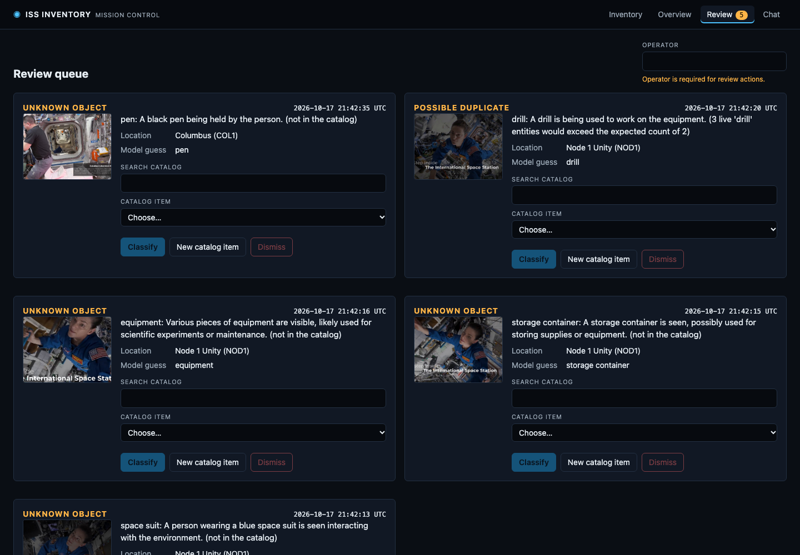
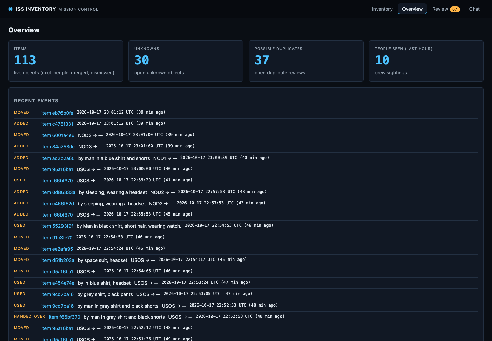

# NASA Omni Inventory POC

An experimental proof of concept for the International Space Station. **An omni model takes video and audio
together**, identifies and tracks objects and people, and keeps a **Postgres inventory** that mission control can
browse, correct and question in natural language. It is built only from open-source components and runs as
**Podman containers managed by systemd**, on the host OS the hardware already has.

Status: running end to end against NASA's public-domain *Step Inside the International Space Station* tour video.
This is experimental; known limits are listed below and in `docs/QUESTIONS.md`.


## What runs

**Production target:** a single Dell **GB10** on the ISS, running NVIDIA's standard Ubuntu-based stack. Everything
below is one Podman network (`nasa`) on that one box. The POC was developed and measured on three Ubuntu 24.04
T4 VMs standing in for it, because T4s have no bf16 and Gemma 4 needs a whole 4x T4 VM in fp32.

| Tier | Component | What it does |
|---|---|---|
| inference | **Gemma 4 12B** (Google, Apache-2.0), vLLM | Perception omni model. 6 frames + speech audio per window, returns a structured observation: objects with boxes, people (appearance only), events, location hint. On the GB10 the same server also answers chat |
| | **Whisper large-v3-turbo** (OpenAI, MIT), vLLM | Speech transcript of record |
| | **DiffusionGemma-26B INT8** (vLLM) + structured decision server | Decision model: "same object or new?" and speech-act classification, with calibrated probabilities |
| | **Gemma 4 12B QAT-W4A16** | Chatbot model on split development hosts only; not installed on the GB10 |
| app | **perception** | ffmpeg ingest, then OWLv2 (Google) detection + DINOv2 (Meta) embeddings, then the Gemma window, then the closed-world reconciler (dedup, revisit, person tracks, privacy), then the inventory API |
| | **inventory-api** (FastAPI) | Source-of-truth API: items, review queue, merge and unmerge, ranked duplicate candidates, events, search, media. Applies `contracts/db/*.sql` at start-up |
| | **agent** (+ MCP server) | Grounded chatbot. It cites items, windows and catalog entries, works out time windows itself, and falls back to answers built only from tool data; MCP attach point for an external agent platform |
| | **dashboard** (React + nginx) | Inventory with filters, review queue (side-by-side duplicates, merge/undo, bbox overlays), overview, add/edit, chat with live status |
| | **tls** (nginx) | Terminates HTTPS on 443, the only port published off the host |
| data | **Postgres 16 + pgvector** | Inventory database, the source of truth |
| | **RustFS** (S3, Apache-2.0) | Frames, crops, evidence images, raw model replies, operator photos |

**Every model is US-origin** (Google, OpenAI, Meta). Qwen2.5-Omni was the first omni model and is retired. On 8
NASA windows Gemma 4 gave 0 whole-frame junk boxes out of 50 objects, against Qwen's 35 of 73, and named specific
ISS hardware. NVIDIA Cosmos Reason is post-trained from Qwen-VL; see `research/07-us-models.md` for that and for
the Nemotron 3 Nano Omni option on GB10.

The design, requirements (R1 to R12) and decisions are in [`docs/ARCHITECTURE.md`](docs/ARCHITECTURE.md). The
research behind it is in [`research/`](research/).

## Deploying

Everything is in [`deploy/`](deploy/README.md): kube YAML played by `podman kube play`, Quadlet units that put
the same YAML under systemd, and the GPU model servers as `.container` units with CDI GPUs. Hosts: Ubuntu
22.04/24.04 or RHEL 9/10, Podman 4.9+. All credentials are generated on the host into podman's secret store;
none are stored in this repo.

```bash
deploy/scripts/host-setup.sh                 # podman, NVIDIA driver + toolkit, CDI spec
PODMAN="sudo podman" scripts/build-images.sh # service images into the root store Quadlet runs from
deploy/scripts/install-inference.sh gemma4 dgemma dgemma-decision asr
deploy/scripts/install-app.sh                # data + app + TLS tiers as systemd units; idempotent

PODMAN="sudo podman" scripts/load-sample-video.sh tour.mp4   # put a feed on the media volume
sudo systemctl start perception                              # start ingest once a feed is attached
```

On a laptop, the data and application tiers run from the same manifests without systemd, root or a GPU:

```bash
scripts/stack.sh up --build      # dashboard on http://localhost:8080/
scripts/stack.sh status
scripts/stack.sh down --volumes
```

Inventory, review queue, add/edit and the overview all work there; only chat needs a model server, which
`scripts/stack.sh up --endpoints <file>` can point at.

The OpenShift / Open Data Hub manifests the prototype originally ran on are kept, superseded, in
[`k8s/`](k8s/README.md).

## How duplicates are kept down

The ISS is a closed world, and the reconciler uses that:
1. Labels are mapped to the **catalog**, using synonyms.
2. Repeated listings from omni are **consolidated within each window**.
3. Candidates come from **pgvector** search over DINOv2 crops of full-resolution frames.
4. **Hard gates** rule out impossible matches: class, and transit between modules too fast to be real.
5. Matches fall into **three bands**:
   - **auto-merge** at ≥ 0.85;
   - **DiffusionGemma decides** between 0.5 and 0.85;
   - **new** below 0.5.
6. A **possible-duplicate review** opens when an item's `expected_count` would be exceeded.
7. Fungible items (food packs, wipes and so on) are kept as **stock counts**, not individual entities.

Unknown objects go to the **review queue** with image, description, timestamp, location and the model's guess. NASA
can classify them, create a new catalog item, merge them into an existing item, or dismiss them.

| Inventory with filters | Review queue (unknowns, with images) |
|---|---|
|  |  |
| **Overview / recent events** | **Add an unseen item (image required)** |
|  |  |

## Development process: spec first, strict TDD, eval gates

Every component was built from a spec with acceptance criteria (`docs/spec/*.md`, for example `AC-PER-22`) by a
multi-agent pipeline: **tester** (red) → **developer** (green) → **adversarial reviewer** → **fixer** →
**verifier**. The cycles are logged in [`docs/tdd-log/`](docs/tdd-log/). Each integration bug found on a real
deployment was turned into a failing test before it was fixed.

```bash
make venvs   # python venvs + dashboard node_modules
make test    # all suites; needs local Postgres: podman run -d --name nasa-pg-test -p 55432:5432 \
             #   -e POSTGRES_PASSWORD=test -e POSTGRES_DB=inventory pgvector/pgvector:pg16
make eval    # identification eval with gated thresholds (eval/thresholds.yaml)
make lint
```

| Suite | Tests |
|---|---|
| inventory-api | 549 |
| perception | 1660 |
| agent | 668 |
| eval | 408 (plus the scoring and gate steps) |
| dashboard | 473 |
| end-to-end | 30 |

Last full run: 2026-11-17, all green (`make test`, `make lint`).

**Product review loop.** A Playwright reviewer agent drives the live dashboard, takes screenshots and judges them
against the diagram and specs (`docs/ui-review/`). Each round's findings become spec amendments, failing tests,
fixes and redeploys.

| Round | Result |
|---|---|
| 1 | 22 findings (3 P1) |
| 2 | 14 of 22 fixed, 0 regressions, 17 new findings |
| Round-2 fixes (live check) | the five standard chat questions now answer correctly in one conversation, in 10–21 s, down from up to 64 s |

The eval gates cover:
- duplicate rate and pairwise F1;
- location accuracy;
- unknown recall and sighting recall;
- **revisit duplication** (the same scene again after 15 min);
- **person-track recall**;
- **no media from sleep-cue (crew quarters) windows**;
- chatbot QA.

They include omni profiles that copy real model behaviour seen in deployment: objects repeated in every frame,
replies cut off at the token limit, and people reported only in `people[]`.

## Measured on the T4 development hosts

Azure policy denied A10s, so every number below is from T4s. The GB10 profile in
[`deploy/README.md`](deploy/README.md#gb10-production-target--untested) is untested.

| | Value |
|---|---|
| OWLv2 detection | 0.35 s/frame on a T4, against 14 s/frame on 4 CPU threads |
| DiffusionGemma decision | ~0.4 to 0.9 s, p(same) = 0.99 on a clear same-object pair |
| Chatbot answer (tool calls + grounding) | ~9 s |
| Omni window (6 frames + audio) | ~20 s (≈550 output tokens at ~28 tok/s); 80% of perception wall time |
| Duplicates, first 8 windows of the tour | 56 entities before the real-video fixes, 16 after |
| Full tour, first pass (~75 windows, 8 modules) | 0 errors; locations followed the tour (COL1, LAB1, NOD1-3, CUP1, ZARYA, ZVEZDA); DiffusionGemma matched 41 of 44 "same or new?" questions to existing items |
| Omni replies hitting the 700-token cap | 77% (42 of 44 salvaged instead of dropped) |
| **Real-video location accuracy** (`make eval-real`, NASA captions as ground truth) | **0.750** with Gemma 4 (0.391 before module resolution), 0 wrong modules, module coverage 0.889 |
| Privacy (sleep cue / crew quarters) | 0 stored media and 0 searchable text in private windows (verified in RustFS and `/search`) |
| Second pass (video looped) | 22 new entities right after the loop restart, then 5 in the next 11 windows: revisit dedup after a long gap is the main open issue (QUESTIONS #29) |

Real time at a 4 s stride needs roughly 5× the omni decode speed (L4/A10-class or better). The POC runs with a
12 s stride. See `docs/QUESTIONS.md` #26.

## Known limits and open questions

`docs/QUESTIONS.md` is the decision log. The headline items:
- **Hardware.** The development environment only allowed T4 GPUs; the GB10 profile has not been run on GB10
  hardware.
- **High availability.** One box, one Postgres container. The cluster deployment had a CloudNativePG pair; the
  Podman deployment deliberately does not, because the production target is a single node.
- **Crew privacy.** People are described by appearance only; there are no biometrics. Crew quarters and the WHC
  are no-capture zones, and that policy fails closed.
- **Omni hallucinations.** Omni sometimes names objects the detector does not confirm (a "drill" next to a
  cable-covered rack). Such omni-only sightings store no appearance exemplar and attach to the most recent
  same-class item in the module. Implausible ones surface through the expected-count duplicate reviews.
- **MCP on aarch64 — unverified on the GB10.** The `cryptography` 50.0.2 wheel that the `mcp` package imports
  dies with SIGILL on an Apple Silicon podman machine (reproduced on a plain `python:3.11-slim` image, so it is
  the wheel and the VM, not this repo's packaging), and the MCP container restarts in a loop there. The
  prototype ran MCP on x86_64. **The GB10 is also aarch64, so this must be checked on the box**; if it bites,
  pin a `cryptography` version that works there. Nothing else in the stack imports it: the API, dashboard,
  perception and chat are unaffected.
