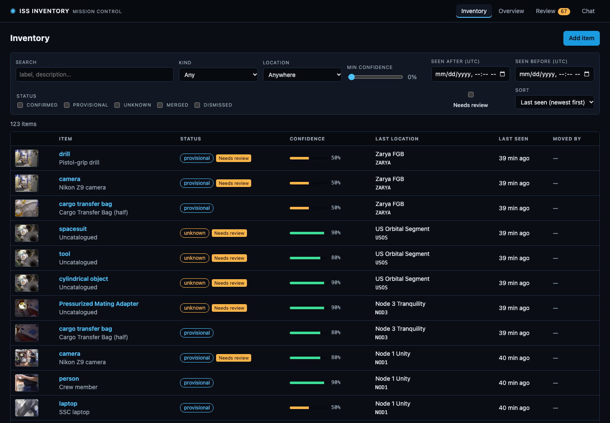
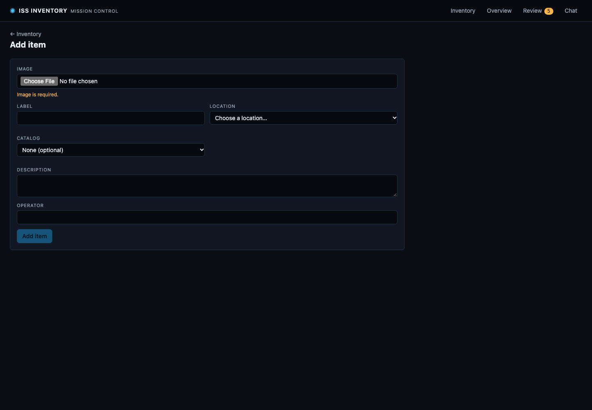

# NASA Omni Inventory POC

An experimental proof of concept for the International Space Station. **vLLM-Omni takes video and audio together**,
identifies and tracks objects and people, and keeps a **Postgres inventory** that mission control can browse, correct
and question in natural language. It is built only from open-source components, on OpenShift with Open Data Hub (the
upstream of Red Hat OpenShift AI).

Status: running end to end on ARO (2026-10-17) against NASA's public-domain *Step Inside the International Space
Station* tour video. This is experimental; known limits are listed below and in `docs/QUESTIONS.md`.



## What is deployed

| Namespace | Component | What it does |
|---|---|---|
| `nasa-inference` | **vLLM-Omni** serving Qwen2.5-Omni-7B, thinker only (fp16, TP2 on T4) | Takes 6 frames + audio per window and returns a structured observation: objects, people, events, location hint |
| | **Qwen3-ASR-1.7B** (vLLM) | Speech transcript of record |
| | **Qwen3-8B-AWQ** (vLLM, tool calling) | Chatbot / inventory agent |
| | **DiffusionGemma-26B INT8** (vLLM TP4) + structured decision server | Decision model: "same object or new?" and speech-act classification, with calibrated probabilities |
| `nasa-app` | **perception** (Python, own T4) | ffmpeg ingest, then OWLv2 detection + DINOv2 embeddings, then omni window, then the closed-world reconciler (dedup), then the inventory API |
| | **inventory-api** (FastAPI) | Source-of-truth API: items, review queue, merges with full undo detail, events, search, media |
| | **agent** (+ MCP server) | Grounded chatbot that cites entity, window and catalog IDs; refuses ungrounded answers; inventory-first "dreaming" memory |
| | **dashboard** (React + nginx) | Inventory with filters, review queue, overview and events, add/edit items, chat |
| `nasa-data` | **Postgres 16 + pgvector** (CloudNativePG, 2 instances) | Inventory database, the source of truth |
| | **RustFS** (S3, Apache-2.0) | Frames, crops, evidence images, raw omni replies, operator photos |
| `opendatahub` | **Open Data Hub 3.3** | KServe (RawDeployment), dashboard, TrustyAI, model registry |

The design, requirements (R1 to R12) and decisions are in [`docs/ARCHITECTURE.md`](docs/ARCHITECTURE.md). The
research behind it (vLLM-Omni realtime, tracking and dedup, audio fusion, the ISS domain, agent memory, decision
models) is in [`research/`](research/).

## How duplicates are kept down

The ISS is a closed world, and the reconciler uses that:
1. Labels are mapped to the **catalog**, using synonyms.
2. Repeated listings from omni are **consolidated within each window**.
3. Candidates come from **pgvector** search over DINOv2 crops of full-resolution frames.
4. **Hard gates** rule out impossible matches: class, and transit between modules too fast to be real.
5. Matches fall into **three bands**:
   - **auto-merge** at ≥ 0.85;
   - **DiffusionGemma decides** between 0.5 and 0.85;
   - **new** below 0.5.
6. A **possible-duplicate review** opens when an item's `expected_count` would be exceeded.
7. Fungible items (food packs, wipes and so on) are kept as **stock counts**, not individual entities.

Unknown objects go to the **review queue** with image, description, timestamp, location and the model's guess. NASA can
classify them, create a new catalog item, merge them into an existing item, or dismiss them.

| Inventory with filters | Review queue (unknowns, with images) |
|---|---|
|  |  |
| **Overview / recent events** | **Add an unseen item (image required)** |
|  |  |

## Development process: spec first, strict TDD, eval gates

Every component was built from a spec with acceptance criteria (`docs/spec/*.md`, for example `AC-PER-22`) by a
multi-agent pipeline: **tester** (red) → **developer** (green) → **adversarial reviewer** → **fixer** → **verifier**.
The cycles are logged in [`docs/tdd-log/`](docs/tdd-log/). Each cluster-integration bug was turned into a failing
test before it was fixed (see the "cluster integration" sections of the TDD logs).

```bash
make venvs   # python venvs + dashboard node_modules
make test    # all suites; needs local Postgres: podman run -d --name nasa-pg-test -p 55432:5432 \
             #   -e POSTGRES_PASSWORD=test -e POSTGRES_DB=inventory pgvector/pgvector:pg16
make eval    # identification eval with gated thresholds (eval/thresholds.yaml)
make lint
```

| Suite | Tests |
|---|---|
| inventory-api | 336 |
| perception | 717 |
| agent | 340 |
| eval | 340 |
| dashboard | 190 |
| end-to-end | 19 |

The eval gates are duplicate rate, pairwise F1, location accuracy, unknown recall, sighting recall and chatbot QA. They
include omni profiles that reproduce the real model's behaviour seen on the cluster: repeating objects in every frame,
and replies cut off at the token limit.

## Deploying

The cluster needs `oc` logged in as cluster-admin, plus `helm` and `jq`. All secrets are generated on the cluster;
none are stored in this repo.

```bash
export KUBECONFIG=~/path/to/dedicated/kubeconfig
./scripts/bootstrap.sh                       # gpu, odh, cnpg, data, inference, app (idempotent)
ONLY="data app" ./scripts/bootstrap.sh       # or individual steps
./scripts/load-sample-video.sh tour.mp4      # put a sample feed on the perception volume
./scripts/reset-observations.sh [--yes]      # clear observation data, keep the seed (dry run without --yes)
```

## Measured on the cluster (T4 GPUs; the Azure policy denied A10)

| | Value |
|---|---|
| OWLv2 detection | 0.35 s/frame on a T4, against 14 s/frame on 4 CPU threads |
| DiffusionGemma decision | ~0.4 to 0.9 s, p(same) = 0.99 on a clear same-object pair |
| Chatbot answer (tool calls + grounding) | ~9 s |
| Omni window (6 frames + audio) | ~20 s (≈550 output tokens at ~28 tok/s); 80% of perception wall time |
| Duplicates, first 8 windows of the tour | 56 entities before the real-video fixes, 16 after |
| Full tour, first pass (~75 windows, 8 modules) | 0 errors; locations followed the tour (COL1, LAB1, NOD1-3, CUP1, ZARYA, ZVEZDA); DiffusionGemma matched 41 of 44 "same or new?" questions to existing items |
| Omni replies hitting the 700-token cap | 77% (42 of 44 salvaged instead of dropped) |
| Second pass (video looped) | 22 new entities right after the loop restart, then 5 in the next 11 windows: revisit dedup after a long gap is the main open issue (QUESTIONS #29) |

Real time at a 4 s stride needs roughly 5× the omni decode speed (L4/A10-class or better). The POC runs with a
12 s stride. See `docs/QUESTIONS.md` #26.

## Known limits and open questions

`docs/QUESTIONS.md` is the decision log. The headline items:
- **Hardware.** This environment only allows T4 GPUs.
- **OpenShift AI.** No Red Hat pull secret was available, so Open Data Hub was used instead.
- **OpenClaw.** "Red Hat OpenClaw Enterprise" could not be verified as a product. An MCP server exposes the
  inventory tools so it can be attached later.
- **Crew privacy.** People are described by appearance only; there are no biometrics. Crew quarters and the WHC are
  no-capture zones, and that policy fails closed.
- **Omni hallucinations.** Omni sometimes names objects the detector does not confirm (a "drill" next to a
  cable-covered rack). Such omni-only sightings store no appearance exemplar and attach to the most recent same-class
  item in the module. Implausible ones surface through the expected-count duplicate reviews.
